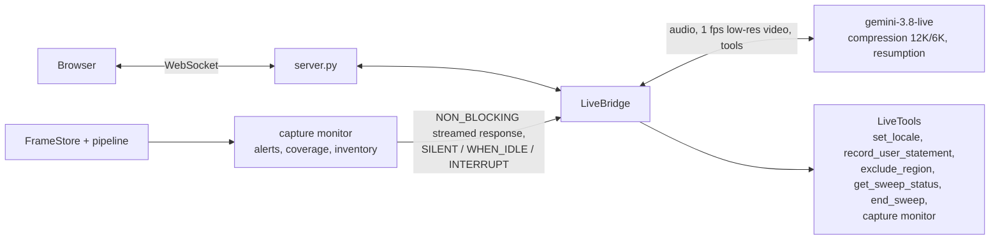

# Architecture

One FastAPI process, one WebSocket per sweep, and a file-producing pipeline. The live model talks; code computes every number.

## Pipeline

```mermaid
flowchart LR
    phone["Phone browser<br/>getUserMedia, AudioWorklet"] -->|"binary: mic PCM, full-res stills"| ws["FastAPI /ws/sweep<br/>token, Origin, size caps"]
    ws --> store["FrameStore<br/>save still, blur/glare/speed gate"]
    store --> kf["keyframes<br/>perceptual-hash dedupe"]
    kf --> sp["spines<br/>Gemini boxes + RF-DETR count, reconcile"]
    sp --> tr["tracks / rows<br/>ORB homography, carry-over dedupe"]
    tr --> sc["scale<br/>ArUco homography or format prior"]
    sc --> rd["reading<br/>crop, Gemini batch read + RapidOCR"]
    rd --> rs["resolution<br/>Google Books, Open Library isbn/editions, gate"]
    store --> room["room<br/>Depth Anything V2 + planes, ArUco rescale"]
    store --> it["items<br/>Gemini detection"]
    rs --> ap["appraisal<br/>appraisal_reasons"]
    ap --> pr["pricing<br/>Bookchor, Pustakkosh, Penguin UK, listings, FX"]
    it --> pr
    room --> pk["packet<br/>assemble, crops, totals, review queue"]
    pr --> pk
    pk --> out["claim_packet.json + report.html"]
```

Every stage is `run(sweep) -> StageOutput`: it reads earlier `stages/*.json` and writes its own. `python -m libclaim.pipeline runs/<id> --from <stage>` replays from any stage against the cache. `keyframes` and `spines` stream during the sweep; `tracks`, `scale`, `reading` and `resolution` run per segment (a run of frames over one shelf unit) as segments close and reading results flow straight into per-book resolution; `room`, `items`, `appraisal`, `pricing` and `packet` run after the sweep.

## Live session path

- The browser sends microphone PCM and full-resolution stills. The server forwards audio and a low-resolution frame about once per second to the live model, and saves every still for the pipeline.
- Blur, glare, speed and missed-region alerts and inventory updates reach the model as streamed responses of a NON_BLOCKING monitor tool. Scheduling decides whether the model speaks now (`INTERRUPT`), when idle (`WHEN_IDLE`) or only absorbs the information (`SILENT`). If no monitor call exists yet, the update goes as a text turn.
- A `GoAway`, a 429 or a dropped connection triggers a reconnect with the latest resumption handle and exponential backoff. Audio during the gap is buffered, up to 100 chunks or 10 s.
- `end_sweep` (the agent calling it on "I am done", or an abrupt disconnect) runs the same `finish()` with the same deadline. The summary is read back as an injected turn whose text is built from the packet, with an instruction to read it word for word.

## Which model does what

| Job | Model or library | Notes |
|---|---|---|
| Voice, coaching, tool calls | `gemini-3.8-live` | Never states a number unless a tool returned it |
| Spine boxes (2 overlapping tiles per still) | `gemini-3.5-flash-lite` and `gemini-3.1-flash-lite`, alternated | Structured output; per-model RPM and daily limits in `config/llm.yaml` |
| Spine count, gap check | RF-DETR nano ONNX, local | Compared with the Gemini boxes per row; a difference over 10% re-queries the row with the tie-break model (at most 5 rows) |
| Spine transcription | The flash-lite pair, batches of 24 crops | Title, author, publisher as printed; `legible=false` when unsure |
| Second read of each crop | RapidOCR, local CPU, one shared pool | Corroborates, or contradicts, the Gemini read |
| Identification | Google Books search, Open Library `/isbn` and `/works/.../editions` | `accept_identification` decides; invented or unsupported titles stay `unidentified` |
| Non-book items | The flash-lite pair, batches of 4 images | Categories from `config/taxonomy.yaml` |
| Spine masks | SAM 2.1 (optional) | Used only if the mask agrees with the detector box |
| Room depth | Depth Anything V2 Metric-Indoor-Small (optional) | RANSAC planes, floor polygon, shelved wall area |

## Where scale comes from

1. A printed ArUco marker on the shelf front edge gives a homography from the image plane to centimetres; a 2.5 cm recess correction moves it to the spine plane. A marker seen in one frame reaches neighbouring frames through the frame-to-frame homography at reduced confidence (`scale_method: aruco_homography`).
2. No marker: spine dimensions are left empty. A format prior (nearest of the book formats in `config/taxonomy.yaml`, chosen from the detector box aspect ratio) goes to `dims_estimated_from_prior` and the report shows it as an estimate (`scale_method: book_format_prior`, confidence 0.3, `scale.prior_confidence`).
3. Room geometry comes from monocular metric depth as a prior, rescaled by marker sightings when there are any. The packet records which method produced it.

## Where prices come from

| Price | Source |
|---|---|
| India new | Bookchor ISBN page JSON-LD `NewCondition`, then Pustakkosh store API |
| India used | Bookchor `UsedCondition`, then Pustakkosh `_Used`; otherwise derived: sourced new times a versioned condition factor, labelled `derived` |
| Second country (GB) | Penguin UK RRP for the exact ISBN where robots.txt allows; otherwise converted from the first country at the ECB rate (Frankfurter), labelled `converted` |
| Item ranges | Category listing pages that robots.txt allows (IKEA India, Urban Ladder, Vijay Sales, Nilkamal): P25 to P75 when at least 5 matches, each bound a real URL |

Every price has `source`, `url`, `retrieved_at` and a `cache_ref` to the saved response. The ISBN must appear on the page. A page for another ISBN, a redirect to search, or an out-of-stock offer is recorded as `not_found` or `equivalent_edition`, never priced silently. Art, signed or first-edition claims, antiquarian works and values over the locale threshold become `needs_appraisal` and are not priced. Lines with no price are counted in `excluded_from_totals`.

## Budget, quota and deadline

- Budget: each Gemini call is preceded by `Budget.check()` (and a small reserve) and followed by `Budget.record()` into `runs/spend.jsonl`, at paid-tier rates. At USD 2.00 further calls are refused and the live session closes with the reason `budget_exceeded`; the pipeline falls back to local-only results.
- Quota: per-model `AsyncLimiter` for RPM and a daily counter in `runs/_quota.json` for RPD. A 429 reads the retry delay (capped at 30 s) and fails over to the other vision model; after 3 rounds the call fails and the book goes to review with the reason.
- Deadline: after the sweep ends the pipeline has 240 s (`deadline_s`). Vision work not finished 150 s after the sweep (`vision_cutoff_s`) is cut and the remaining boxes come from the local detector only, flagged. Unfinished reads and resolutions are reported in the review queue as unfinished, never guessed. The packet is always written.
- Scraping: 1 request per second per host, robots.txt checked per host and path, SSRF guard on redirects, identified User-Agent from the environment.
